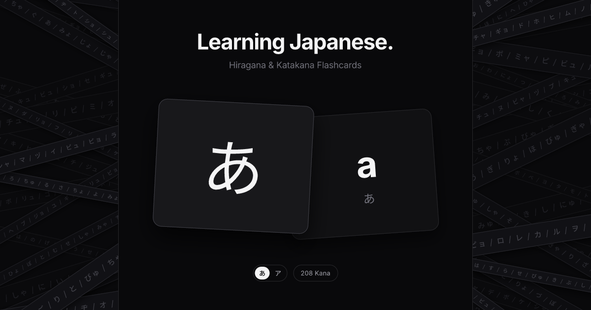

# Learning Japanese.

Ultra-minimalist Japanese **Hiragana** and **Katakana** flashcard web app built with React, TypeScript, Vite, and Bun.



## Features

- **Complete Kana Set (208 cards)** — 104 Hiragana + 104 Katakana:
  - 46 Gojūon (`あ–ん` / `ア–ン`)
  - 25 Dakuten & Handakuten (`が–ぽ` / `ガ–ポ`)
  - 33 Yōon combinations (`きゃ–ぴょ` / `キャ–ピョ`)
- **Script Filter** — switch between Hiragana (`あ`), Katakana (`ア`), or all 208 cards, shuffled via Fisher–Yates without repeating the boundary card on reshuffle.
- **Zero-Clutter UI** — centered flashcard only, monochrome Zinc dark/light theme, no counters or distractions.
- **Ambient Kana Tapes** — procedural 3-layer monochrome kana-tape side background rendered on a single cached-sprite `<canvas>`, skipping the center column and pausing automatically when hidden, on narrow viewports (`<= 640px`), or with `prefers-reduced-motion: reduce`.

## Controls

| Action | Gesture / Key |
| --- | --- |
| Flip card | Tap / Click, `Space`, or `Enter` |
| Next card | Swipe / flick left or right, `←`, or `→` |

## Getting Started

Requires [Bun](https://bun.sh/).

```bash
bun install
bun run dev
```

## Scripts

```bash
bun run dev      # Start Vite dev server
bun run build    # Type-check (tsc --noEmit) and build production bundle
bun run preview  # Preview production build
bun test         # Run unit tests
```

## Project Structure

```text
.
├── design/                 # FigCraft design source & preview renders
├── public/
│   └── og.png              # Social / Open Graph thumbnail (1200×630)
├── src/
│   ├── components/
│   │   ├── AmbientTapes.tsx  # Canvas ambient kana-tape background
│   │   └── Flashcard.tsx     # 3D flip & pointer swipe flashcard
│   ├── data/
│   │   ├── kana.ts           # 208-card dataset & deck shuffler
│   │   └── kana.test.ts      # Dataset & shuffle unit tests
│   ├── App.tsx
│   ├── index.css
│   └── main.tsx
├── index.html
├── package.json
├── tsconfig.json
└── vite.config.ts
```

## Tech Stack

- React 19
- TypeScript 5
- Vite 6
- Bun
- Plain CSS (Zinc dark/light tokens)
